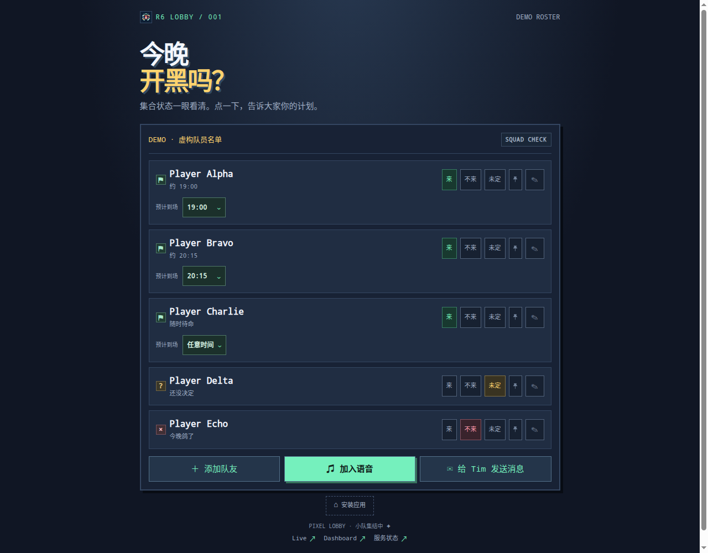
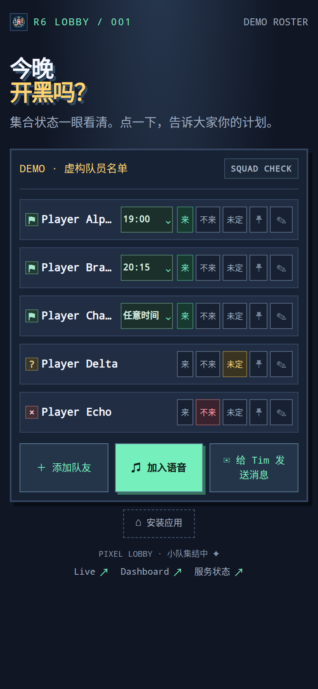
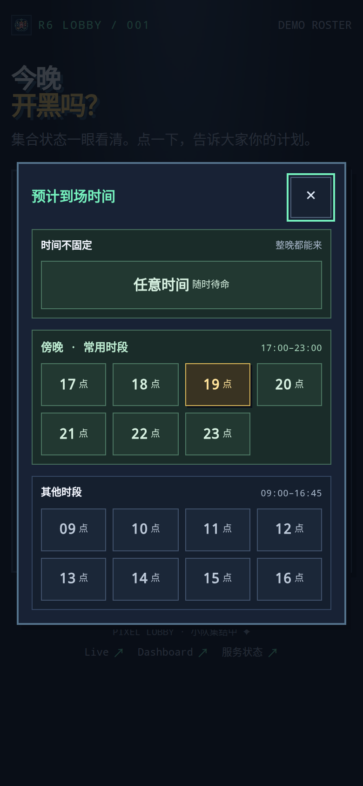

# R6 Lobby

**A tiny, self-hosted squad availability board.** Who is playing tonight, when can they join, and who is ready whenever?

[中文说明 →](README.zh-CN.md) · [Website ↗](https://apps.timhuang.net/r6-lobby/en/)

> Open source under the [MIT License](LICENSE).



## What it does

- Shared **Coming / Not coming / Undecided** availability, with names and arrival times.
- Two-step arrival picker: 09:00–23:00, quarter-hour slots (23:00 is the last slot), plus **Any time / Ready whenever**.
- Concrete times sort chronologically; flexible arrivals follow them. A browser-local pin can put one teammate first.
- Add, rename and remove teammates; compact mobile layout; collapse larger groups after five people.
- Install-to-home-screen guidance, manifest and service worker. API responses are never cached.
- Simplified Chinese and English UI, with a switcher; the choice is remembered per browser and switching never writes to the shared roster.
- Optional server-side ntfy message relay. Notification destinations never belong in browser code.

The interface ships with Simplified Chinese and English, with the choice remembered per browser. These documents are bilingual too. This is not a game client, matchmaking system, presence detector or Ubisoft/Tencent integration.

## Small decisions that make gathering easier

- **Evening hours first.** 17:00–23:00 is highlighted and placed above daytime slots, matching when the group usually plays.
- **Two small choices, not one long menu.** Pick an hour, then a quarter hour; the last slot is 23:00.
- **Ready whenever is not a fake clock time.** “Any time” reads as “Ready whenever” on the card instead of forcing a made-up arrival estimate.
- **Your teammate, your pin.** Browser-local pinning keeps a frequent partner first without rearranging everyone else's shared board.
- **Five at a glance.** Larger rosters collapse after five, while the remaining players stay one tap away.
- **Status is not just a color.** Coming, absent and undecided also have distinct symbols and text.
- **Keep the frequent action obvious.** Voice join is the primary button; rename/delete stay behind the pencil, with deletion confirmation.
- **A row that fits a phone.** Compact status controls and the arrival selector share the member row; long names truncate rather than push everything apart.

## Screenshots


| Phone board | Arrival-time picker |
|---|---|
|  |  |

## Run locally

Requires Python **3.10+**; server uses only the Python standard library. No npm or pip installation is needed to serve the app.

```sh
python3 server.py
# Open http://127.0.0.1:8090/
```

The roster starts empty. Add your own players through the UI. Data is saved to `data/people.json`, which is ignored by Git. To change settings, export environment variables (the server does **not** automatically load `.env`):

```sh
export R6_HOST=127.0.0.1
export R6_PORT=8090
export R6_DATA_FILE=./data/people.json
# Optional: set privately, not in committed scripts
# export R6_NTFY_TOPIC=...
python3 server.py
```

Set the voice-room button URL in `web/index.html` before deployment; its bundled `#voice` target is intentionally unconfigured. The message button reports a relay error until a notification destination is configured. Keep real topics/tokens, rosters and deployment files out of Git.

## Deployment and trust model

Put an HTTPS reverse proxy in front of the loopback server. Serve it at the origin root: the app uses absolute `/api/...`, manifest and worker URLs. Home-screen installation capabilities depend on platform and HTTPS; an offline shell cannot read or update the shared roster.

**There is no authentication or per-player authorization.** Anyone who can reach the application can replace the whole roster, change other people's names/statuses, or send messages when notifications are enabled. This is appropriate only for a deliberately shared, trusted group or an authenticated reverse proxy. Do not advertise an unprotected deployment as private.

Writes are atomic JSON replacements, not collaborative merges: simultaneous editors can overwrite each other (last write wins). The current client refreshes on page load; it does not provide live push updates. There is no server-side message rate limit: public deployments may receive spam or exhaust notification quotas. Request-size/field limits do not prevent abuse. A notification response means the relay accepted the message, not that a phone displayed it.

## Data and code

- `web/`: portable frontend, icons, manifest and worker.
- `server.py`: static serving, `/api/people` store and `/api/note` relay.
- `docs/demo-roster.json`: synthetic screenshot data only; not automatically loaded.
- `tests/`: isolated HTTP checks and frontend regression checks.

The portable snapshot adapts the deployed frontend and backend into one local server. It does not include production infrastructure, credentials, personal roster, backups or deployment history. It does not change the running personal site.

## Checks

```sh
python3 -m unittest discover -s tests -p 'test_*.py' -v
# Optional frontend checks require Node.js (tested with Node 24):
node --check web/app.js
node tests/r6-pin.test.cjs
node tests/r6-any-time.test.cjs
```

HTTP tests use an isolated synthetic roster and a local ephemeral port; they do not contact the live board or send notifications. Screenshots demonstrate rendering, not end-to-end notification delivery. The worker, full mobile install flow, concurrency and every browser/OS combination are not comprehensively tested.

## Relationship and licensing

An independent personal project; not affiliated with, sponsored by or endorsed by Ubisoft or Tencent. Rainbow Six is a trademark of its respective owner. No game assets are bundled.

Licensed under the [MIT License](LICENSE). Third-party trademarks remain the property of their respective owners.
